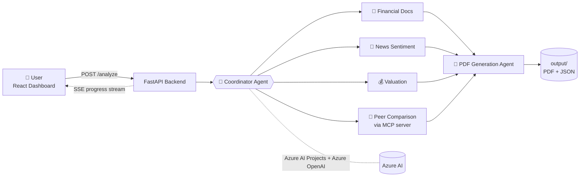

<div align="center">

# 📈 Pitchbook: Multi-Agent Investment Analysis

**Enter a ticker. Six AI agents research it. Get an analyst-style pitchbook.**

Automated financial analysis, news sentiment, valuation modeling and PDF report generation, powered by Azure AI.


</div>

---

> ⚠️ **Disclaimer:** This project is a technical demonstration. Its output is AI-generated, may contain errors, and is **not investment advice**. Always verify figures against primary sources before making financial decisions.

## 📑 Contents

[Overview](#-overview) · [Agents](#-the-agent-team) · [Architecture](#-architecture) · [Tech Stack](#-tech-stack) · [Quick Start](#-quick-start) · [Azure Deployment](#-azure-deployment) · [Configuration](#-configuration) · [API](#-api-reference) · [Usage](#-usage) · [Project Structure](#-project-structure) · [Security](#-security) · [Monitoring & Debugging](#-monitoring--debugging) · [Roadmap](#-roadmap)

## ✨ Overview

Pitchbook turns a company name and ticker into a structured investment report. A coordinator agent delegates work to specialists that read financial documents, score news sentiment, build valuation models and benchmark peers. A final agent assembles everything into a PDF while you watch progress live in the dashboard.

| | Highlight |
|---|---|
| 🤖 | **Multi-agent architecture**: six specialized agents with clear responsibilities |
| ⚡ | **Live progress**: stream each agent's status via Server-Sent Events (SSE) |
| 📊 | **Interactive dashboard**: React UI with nine analysis views and charts |
| 📄 | **PDF pitchbooks**: analyst-style formatting, ready to download |
| ☁️ | **Cloud-ready**: Docker Compose locally, Azure Container Apps in production |
| 🔐 | **Passwordless auth**: Azure Entra ID via `DefaultAzureCredential`, no API keys |

## 🤖 The Agent Team

| Agent | Role | Output |
|-------|------|--------|
| 🧭 **Coordinator** | Orchestrates the workflow and delegates tasks | Task plan and coordination |
| 📑 **Financial Documents** | Extracts and analyzes statements, metrics and KPIs | Financial data analysis |
| 📰 **News Sentiment** | Analyzes market news, sentiment trends and coverage | Sentiment report |
| 💰 **Valuation** | DCF modeling, peer multiples and valuation analysis | Valuation tables and price targets |
| 🔗 **Peer Comparison (MCP)** | Queries comparative stock data via Model Context Protocol | Peer benchmarking |
| 📘 **PDF Generation** | Synthesizes all outputs into a professional report | Final PDF with recommendations |

## 🧭 Architecture



## 🛠️ Tech Stack

| Layer | Technologies |
|-------|--------------|
| **Backend** | Python 3.11+, FastAPI, Uvicorn, Azure AI Projects SDK |
| **Frontend** | React 18, JavaScript, Recharts, React Router |
| **AI** | Azure OpenAI (GPT-4o-mini), Azure AI Services, Model Context Protocol |
| **Infrastructure** | Docker, Azure Container Apps, Azure Container Registry |
| **Auth** | Azure Entra ID (`DefaultAzureCredential`) |

## ⚡ Quick Start

### Prerequisites

- Python 3.11+ and Node.js 18+
- Docker and Docker Compose
- An Azure subscription with an AI Project and an Azure OpenAI deployment
- Azure CLI (`az --version`), signed in with `az login`

### Run locally

**1. Clone**

```bash
git clone https://github.com/YOUR-USERNAME/pitchbook-investment-analysis.git
cd pitchbook-investment-analysis
```

**2. Configure environment files**

```bash
# macOS / Linux                      # Windows (PowerShell / cmd)
cp backend/.env.example backend/.env   # copy backend\.env.example backend\.env
cp frontend/.env.example frontend/.env # copy frontend\.env.example frontend\.env
```

Edit `backend/.env` with your Azure values and `frontend/.env` with the backend URL (see [Configuration](#-configuration)).

**3. Start the backend**

```bash
cd backend
python -m venv venv
source venv/bin/activate        # Windows: venv\Scripts\activate
pip install -r requirements.txt
uvicorn backend_server:app --host 0.0.0.0 --port 8000 --reload
```

**4. Start the frontend**

```bash
cd frontend
npm install
npm start
```

**5. Open the app**

| Service | URL |
|---------|-----|
| Dashboard | http://localhost:3000 |
| Backend API | http://localhost:8000 |
| Swagger docs | http://localhost:8000/docs |

### Or run everything with Docker

```bash
docker-compose up --build
```

This starts the backend on `:8000` and the frontend dashboard on `:3000`.

## ☁️ Azure Deployment

Deploys both services to **Azure Container Apps**, with images built in **Azure Container Registry**. A more detailed walkthrough lives in [`AZURE_DEPLOYMENT_GUIDE.md`](AZURE_DEPLOYMENT_GUIDE.md).

<details>
<summary><b>Step-by-step deployment commands</b></summary>

```bash
# 1. Sign in
az login

# 2. Resource group
az group create --name pitchbook-rg --location eastus2

# 3. Container registry
az acr create --resource-group pitchbook-rg \
  --name pitchbookacr --sku Basic --admin-enabled true

# 4. Registry credentials
ACR_USERNAME=$(az acr credential show --name pitchbookacr --query username -o tsv)
ACR_PASSWORD=$(az acr credential show --name pitchbookacr --query passwords[0].value -o tsv)

# 5. Container Apps environment
az containerapp env create \
  --name pitchbook-env \
  --resource-group pitchbook-rg \
  --location eastus2

# 6. Build and push the backend image
az acr build --registry pitchbookacr --image pitchbook-backend:latest ./backend

# 7. Deploy the backend
az containerapp create \
  --name pitchbook-backend \
  --resource-group pitchbook-rg \
  --environment pitchbook-env \
  --image pitchbookacr.azurecr.io/pitchbook-backend:latest \
  --target-port 8000 \
  --ingress external \
  --registry-server pitchbookacr.azurecr.io \
  --registry-username $ACR_USERNAME \
  --registry-password $ACR_PASSWORD \
  --cpu 1.0 --memory 2.0Gi \
  --env-vars \
    AZURE_OPENAI_ENDPOINT="https://your-openai.openai.azure.com/" \
    AZURE_OPENAI_CHAT_DEPLOYMENT_NAME="gpt-4o-mini" \
    AZURE_AI_PROJECT_ENDPOINT="https://your-project.services.ai.azure.com/api/projects/your-project" \
    AZURE_AI_MODEL_DEPLOYMENT_NAME="gpt-4o-mini" \
    AZURE_SUBSCRIPTION_ID="your-subscription-id" \
    AZURE_LOCATION="eastus2"

# 8. Capture the backend URL
BACKEND_URL=$(az containerapp show --name pitchbook-backend \
  --resource-group pitchbook-rg \
  --query properties.configuration.ingress.fqdn -o tsv)
echo "Backend URL: https://$BACKEND_URL"

# 9. Build and deploy the frontend
az acr build --registry pitchbookacr \
  --image pitchbook-frontend:latest \
  --build-arg REACT_APP_API_URL=https://$BACKEND_URL \
  ./frontend

az containerapp create \
  --name pitchbook-frontend \
  --resource-group pitchbook-rg \
  --environment pitchbook-env \
  --image pitchbookacr.azurecr.io/pitchbook-frontend:latest \
  --target-port 80 \
  --ingress external \
  --registry-server pitchbookacr.azurecr.io \
  --registry-username $ACR_USERNAME \
  --registry-password $ACR_PASSWORD \
  --cpu 0.5 --memory 1.0Gi

# 10. Capture the frontend URL
FRONTEND_URL=$(az containerapp show --name pitchbook-frontend \
  --resource-group pitchbook-rg \
  --query properties.configuration.ingress.fqdn -o tsv)
echo "Frontend URL: https://$FRONTEND_URL"
```

> 🔒 The backend authenticates to Azure AI with Entra ID. In Azure, grant the Container App a **managed identity** with access to your AI Project and OpenAI resource. For production, prefer managed identity pull from ACR over admin credentials.
</details>

<details>
<summary><b>Day-two operations</b></summary>

```bash
# Stream backend logs
az containerapp logs show --name pitchbook-backend \
  --resource-group pitchbook-rg --follow

# Ship a backend update
az acr build --registry pitchbookacr --image pitchbook-backend:latest ./backend
az containerapp update --name pitchbook-backend \
  --resource-group pitchbook-rg \
  --image pitchbookacr.azurecr.io/pitchbook-backend:latest

# Ship a frontend update
az acr build --registry pitchbookacr --image pitchbook-frontend:latest ./frontend
az containerapp update --name pitchbook-frontend \
  --resource-group pitchbook-rg \
  --image pitchbookacr.azurecr.io/pitchbook-frontend:latest

# Scale the backend
az containerapp update --name pitchbook-backend \
  --resource-group pitchbook-rg \
  --min-replicas 1 --max-replicas 5

# Tear everything down
az group delete --name pitchbook-rg --yes
```
</details>

## 🔧 Configuration

### Required Azure resources

| Resource | Purpose | Setup |
|----------|---------|-------|
| Azure AI Project | Agent orchestration | Create in Azure AI Studio |
| Azure OpenAI | Model deployment | Deploy GPT-4o-mini or GPT-4o |
| Azure Container Registry | Image storage | Create with admin enabled (or use managed identity) |
| Azure Container Apps | Hosting | Create an environment for both apps |

### Environment variables

| Variable | Required | Description |
|----------|:--------:|-------------|
| `AZURE_OPENAI_ENDPOINT` | ✅ | Azure OpenAI service endpoint |
| `AZURE_OPENAI_CHAT_DEPLOYMENT_NAME` | ✅ | Model deployment name, e.g. `gpt-4o-mini` |
| `AZURE_AI_PROJECT_ENDPOINT` | ✅ | Azure AI Project endpoint URL |
| `AZURE_AI_MODEL_DEPLOYMENT_NAME` | ✅ | AI model deployment name |
| `AZURE_SUBSCRIPTION_ID` | ✅ | Azure subscription ID |
| `AZURE_LOCATION` | ✅ | Azure region, e.g. `eastus2` |
| `AZURE_ENV_NAME` | ➖ | Environment name |
| `REACT_APP_API_URL` | ✅ | **Frontend only:** backend API URL |

> 💡 **No API keys needed.** The app authenticates with `DefaultAzureCredential`. For local development, run `az login`.

## 📖 API Reference

Interactive docs (Swagger UI) are served at `/docs`.

| Method | Endpoint | Description |
|--------|----------|-------------|
| `GET` | `/health` | Health check |
| `POST` | `/analyze` | Start an analysis workflow |
| `GET` | `/analysis/{session_id}/stream` | SSE stream of real-time progress |
| `GET` | `/analysis/{session_id}/status` | Current analysis status |
| `GET` | `/analysis/{session_id}/result` | Final analysis result |
| `GET` | `/files/{filename}` | Download generated files (PDF, JSON) |

**Example request**

```http
POST /analyze
Content-Type: application/json

{
  "company_name": "Apple Inc.",
  "ticker": "AAPL"
}
```

## 🎯 Usage

1. Open the dashboard at `http://localhost:3000`.
2. Click **Start New Analysis** and enter a company name and ticker, e.g. *Apple Inc.* / *AAPL*.
3. Watch each agent's progress in the **Agent Workflow** panel.
4. Explore the results:

| View | What you get |
|------|--------------|
| 🏢 Company Snapshots | Overview and key metrics |
| 📰 News & Sentiment | Market sentiment analysis |
| 📊 Financial Statements | Income statement, balance sheet, cash flow |
| 💰 Valuation Tables | DCF, multiples, peer comparison |
| 📈 Historical Valuation | Price trends and valuation history |
| 🎯 SWOT Analysis | Strengths, weaknesses, opportunities, threats |
| ⚠️ Risk & Growth | Risk assessment and growth drivers |
| 💡 Investment Thesis | Recommendations and rationale |
| 📁 Document Library | Download generated reports |

5. Click **Export PDF** for the complete pitchbook. Generated files are saved in `output/`.

## 🏗️ Project Structure

```
Pitchbook/
├── backend/                              # FastAPI backend
│   ├── agents/                           # Agent implementations
│   │   ├── agent_coordinator.py          #   Workflow coordinator
│   │   ├── agent_financial_documents.py  #   Financial analysis
│   │   ├── agent_news_Sentiment.py       #   News sentiment
│   │   ├── agent_valuation.py            #   Valuation modeling
│   │   ├── peer_comparision_mcp_agent.py #   Peer comparison (MCP)
│   │   ├── pitchbook_pdf_agent.py        #   PDF generation
│   │   └── news_function.py              #   News-fetching utilities
│   ├── instructions/                     # Agent prompt templates
│   ├── mcp/                              # Model Context Protocol server
│   │   ├── server.py
│   │   ├── stock_analyzer.py
│   │   ├── Dockerfile
│   │   └── pyproject.toml
│   ├── templates/template.txt            # Report template
│   ├── backend_server.py                 # FastAPI application
│   ├── simple_groupchat.py               # Agent orchestration
│   ├── requirements.txt
│   ├── Dockerfile
│   └── .env.example
├── frontend/                             # React frontend
│   ├── src/
│   │   ├── components/                   # AgentWorkflow, CompanySnapshots,
│   │   │                                 # NewsSentiment, FinancialStatements,
│   │   │                                 # ValuationTables, HistoricalValuation,
│   │   │                                 # SwotAnalysis, RiskGrowth,
│   │   │                                 # InvestmentThesis, FileViewer
│   │   ├── App.js · App.css · index.js
│   ├── public/                           # index.html, mock_workflow.json
│   ├── Dockerfile · nginx.conf · package.json · .env.example
├── output/                               # Generated reports
├── docker-compose.yml                    # Local orchestration
├── AZURE_DEPLOYMENT_GUIDE.md             # Detailed deployment guide
└── README.md
```

## 🔒 Security

- **No secrets in code**: credentials live in environment variables / Container Apps configuration.
- **Passwordless Azure access** through Entra ID (`DefaultAzureCredential`).
- **Azure Key Vault** is recommended for production secrets.
- **CORS** restricted to the frontend origin; **HTTPS** on Azure Container Apps ingress.
- **`.gitignore`** excludes `.env` files and other sensitive material.

## 📊 Monitoring & Debugging

| Need | Command |
|------|---------|
| Health check | `curl http://localhost:8000/health` |
| Local backend logs | `docker logs pitchbook-backend -f` |
| Local frontend logs | `docker logs pitchbook-frontend -f` |
| Azure live logs | `az containerapp logs show --name pitchbook-backend --resource-group pitchbook-rg --follow` |
| App status | `az containerapp show --name pitchbook-backend --resource-group pitchbook-rg --query properties.runningStatus` |
| Env vars | `az containerapp show --name pitchbook-backend --resource-group pitchbook-rg --query properties.template.containers[0].env` |

Azure Container Apps provides built-in metrics and log streaming; Application Insights can be added for deeper telemetry.

## 🤝 Contributing

1. Fork the repository
2. Create a branch: `git checkout -b feature/amazing-feature`
3. Commit: `git commit -m "Add amazing feature"`
4. Push: `git push origin feature/amazing-feature`
5. Open a Pull Request

## 🔮 Roadmap

- [ ] Multi-company batch analysis
- [ ] Historical analysis comparison
- [ ] Enhanced PDF customization and branding
- [ ] Real-time market data integration
- [ ] User authentication and multi-tenancy
- [ ] Caching for faster analysis
- [ ] Export to PowerPoint and Excel
- [ ] More financial data providers
- [ ] Custom agent workflows
- [ ] Collaborative editing and sharing

## 📚 Resources

[Azure Container Apps](https://learn.microsoft.com/azure/container-apps/) · [Azure AI Foundry](https://learn.microsoft.com/azure/ai-foundry/) · [Azure OpenAI](https://learn.microsoft.com/azure/ai-services/openai/) · [FastAPI](https://fastapi.tiangolo.com/) · [React](https://react.dev/) · [Model Context Protocol](https://modelcontextprotocol.io/)

---

<div align="center">Built with Azure AI Services</div>
